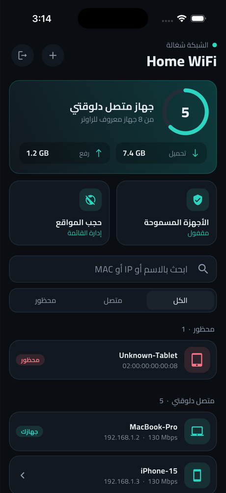
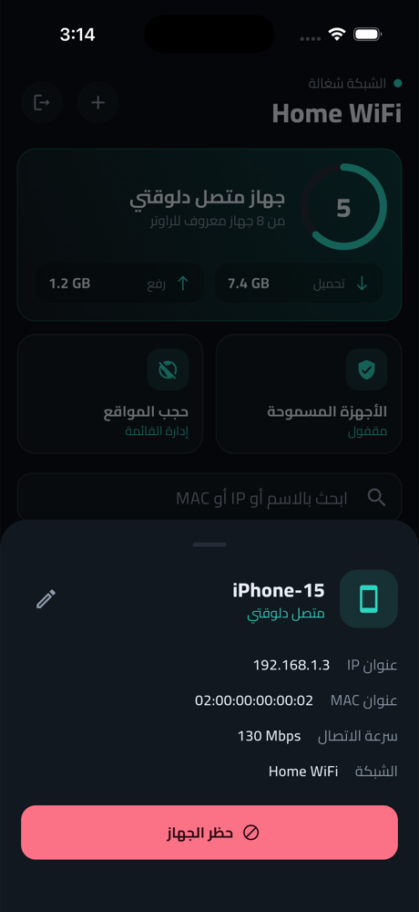
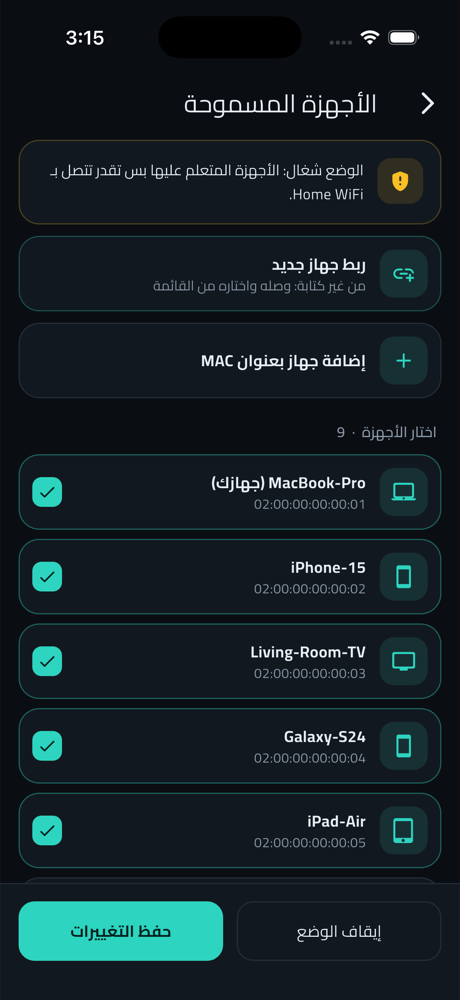
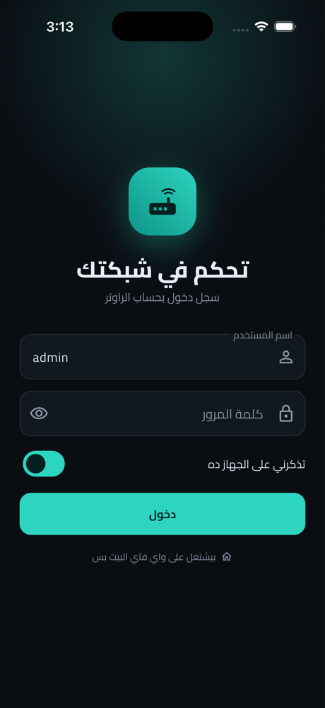
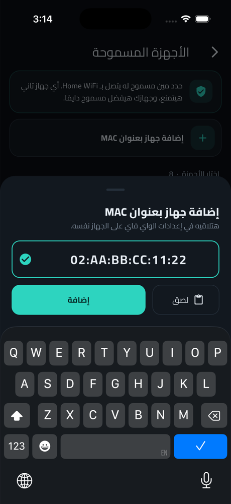
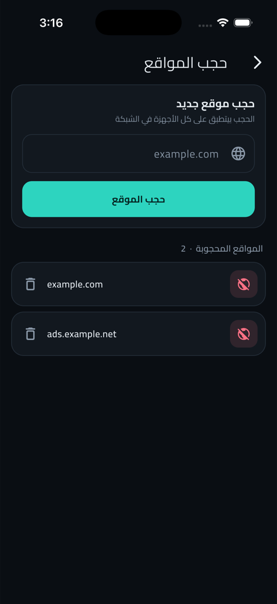

# Router Control

A dark, Arabic-first Flutter app for managing a **Huawei EchoLife DG8045** home router from your phone: see who is connected, block devices, allow only trusted devices, and block websites, without opening the router's web page.

[العربية](#بالعربي) · [Screenshots](#screenshots) · [Try the demo](#try-it-without-a-router) · [Limitations](#known-limitations)

<p align="center">
  
  
  
</p>

> All screenshots use demo mode, so every name and address in them is fake.

## Features

- **Live device list** with search, filters, connection speed, and icons by device type
- **Block and unblock** any Wi-Fi device, from the list or by MAC address
- **Allow-only mode**, so only the devices you pick can join your Wi-Fi
- **Pair a new device without typing**: open the network for up to 3 minutes, then pick the device from a list
- **Website blocking** for the whole network
- **Rename or remove** devices on the router
- **MAC address field** that adds colons for you and accepts pasted text
- **Saved login** in the device's secure storage, with automatic session recovery

### Built-in safeguards

A wrong filter change can knock every device off the network, so the app checks before and after each one:

- It refuses to block the device you are using, and always keeps that device in allow-only mode.
- It backs up the router's stored address list before replacing it.
- After a filter change, it reads the settings back from the router to confirm they were applied.
- It asks for confirmation before changes that disconnect devices or can restart Wi-Fi.
- It stops at the router's 32-address limit.

## Screenshots

| Login | Dashboard | Device details |
|:---:|:---:|:---:|
|  |  |  |

| Allow-only mode | Pair a new device | Add by MAC address |
|:---:|:---:|:---:|
|  |  |  |

| Website blocking |
|:---:|
|  |

## Compatibility

| Item | Status |
|---|---|
| Huawei DG8045, firmware `V100R019C105` (WE, Egypt) | Tested on a real router |
| Other Huawei or ISP routers | Not tested, and may not work |
| iOS Simulator | Tested |
| Physical iPhone and Android | Not tested yet |

The app talks to the router at `192.168.1.1` over your local network, so your phone must be on the router's Wi-Fi or LAN. It does not work from outside the home.

## Getting started

Requires a recent stable Flutter SDK (developed on Flutter 3.47 and Dart 3.13).

```bash
git clone <your-repo-url>
cd router_control
flutter pub get
flutter run
```

Sign in with your router's admin account. The default login is usually printed on the label on the back of the router.

### Try it without a router

Demo mode uses fake data and never contacts a router or touches saved logins:

```bash
flutter run --dart-define=DEMO=true
```

Enter any password on the login screen.

### Run the tests

```bash
flutter test
```

## How it works

The router has no public API, so the app uses the same private JSON endpoints as its web interface:

| Purpose | Endpoint |
|---|---|
| Sign in and out | `system/user_login`, `system/user_logout` |
| List, rename and remove devices | `system/HostInfo` |
| Wi-Fi MAC filter | `ntwk/wlanfilterone`, `ntwk/wlaneffect` |
| Website blocking | `ntwk/urlfilter` |
| Wi-Fi traffic | `ntwk/wifi_info` |

Router quirks the code works around:

- The password is Base64 encoded, then encrypted with RSA PKCS#1 v1.5 using a key from the login page.
- Every write needs a CSRF token, which changes with each response.
- JSON responses are wrapped in `while(1); /* ... */`.
- The router drops idle connections without warning, so each request opens a new one.
- It handles requests one at a time, so the app never sends them in parallel.
- Reading `ntwk/*_host`, `app/qosclass_host` or `ntwk/wlanpin` hangs the web server and ends the session. **Do not call them.**
- Allow-only and block mode share one address list. Reusing that list after switching modes can block the wrong devices.

### Project layout

```text
lib/
├── app/      Screens, theme, and state (flutter_bloc cubits)
├── demo/     Fake router for demo mode
├── router/   Router client, models, filter rules, secure storage
└── main.dart
test/         Unit and widget tests
```

## Known limitations

- **Website blocking is limited.** Sites on HTTPS or different addresses may stay reachable, and it applies to the whole network, not one device.
- **MAC filtering is not strong security.** Phones with random Wi-Fi addresses can come back under a new address, so turn that setting off for your home network if you need reliable blocking.
- **Each filter change can restart Wi-Fi** and disconnect devices for a few seconds.
- **Pairing opens the network** to anyone who has the Wi-Fi password. If the app is closed during pairing, allow-only mode stays off until you turn it on again.
- **Blocking covers one SSID at a time:** the one the device connects to.
- **Not supported:** per-device speed limits, per-device data usage, wired-device blocking, and remote access.

## Security and privacy

- There are no accounts, analytics, or cloud services. The app talks only to your router.
- Your password is kept in the device's secure storage only if you choose "remember me".
- The router uses a self-signed certificate, so the app accepts an unverified certificate from `192.168.1.1`. Use it only on a network you trust.
- Change the default admin and Wi-Fi passwords printed on the router label.

## Disclaimer

Use this app only on routers you own or are allowed to manage. It is an independent project, not affiliated with or endorsed by Huawei or WE. It uses undocumented endpoints that a firmware update could change, and you use it at your own risk.

## License

Released under the [MIT License](LICENSE). The bundled Cairo font is under the [SIL Open Font License](assets/fonts/OFL.txt).

---

## بالعربي

تطبيق Flutter بثيم داكن للتحكم في راوتر **Huawei EchoLife DG8045** من الموبايل، من غير ما تفتح صفحة الراوتر.

**تقدر تعمل إيه:**

- تشوف الأجهزة المتصلة وتبحث فيها.
- تحظر أي جهاز واي فاي أو تفك حظره، من القائمة أو بعنوان MAC.
- تشغل وضع "الأجهزة المسموحة"، فالأجهزة اللي تختارها بس هي اللي تتصل.
- تربط جهاز جديد من غير كتابة.
- تحجب مواقع على الشبكة كلها.
- تغير اسم الجهاز أو تحذفه من القائمة.

**تجربة من غير راوتر:**

```bash
flutter run --dart-define=DEMO=true
```

**للتشغيل على الراوتر:** شغل `flutter run`، وخلي الموبايل متصل بواي فاي الراوتر، وسجل دخول بحساب الأدمن.

**مهم:**

- اتجرب على DG8045 من WE في مصر، ومش مضمون على أي راوتر تاني.
- استخدمه بس على راوتر بتاعك أو معاك إذن تديره.
- حجب المواقع وفلترة MAC ليهم حدود، راجع [Known limitations](#known-limitations).
- المشروع مستقل، ومالوش علاقة بـ Huawei أو WE.
